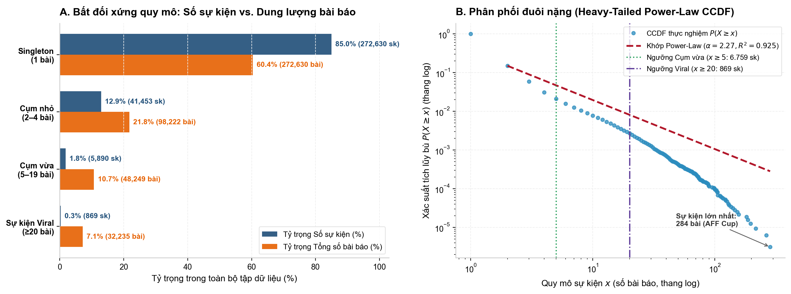
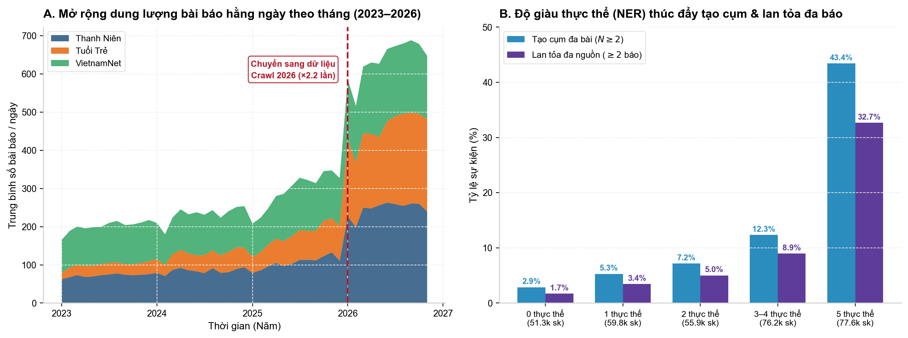
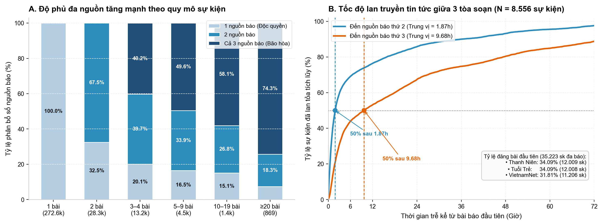
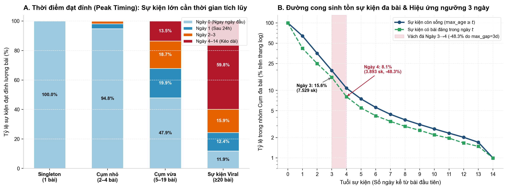
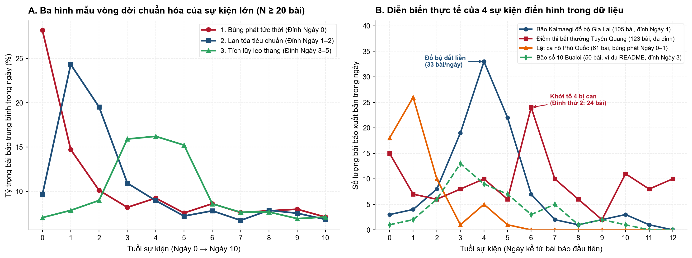
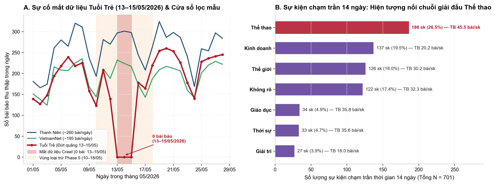
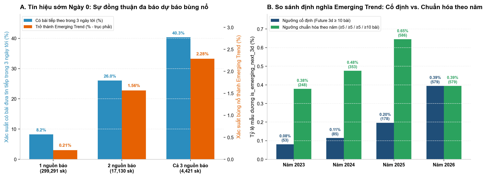

# Báo Cáo Phase 4: Event-Level Data Analysis & Daily Aggregation

Báo cáo này tổng hợp toàn bộ kết quả thực nghiệm của **Phase 4 — Event-level Data Analysis** trên tập dữ liệu tin tức đa nguồn (**463.995 bài báo** từ *Thanh Niên*, *Tuổi Trẻ*, *VietnamNet* trong giai đoạn `01/01/2023 – 07/11/2026`, tương ứng **1.407 ngày liên tục**).

Toàn bộ mã nguồn thực thi và kiểm thử tự động đã được tổ chức chuẩn hóa trong workspace:
- **Bộ tổng hợp dữ liệu theo ngày (`event_id × date`):** `src/analysis/event_aggregator.py`
- **Bộ sinh biểu đồ phân tích Phase 4:** `src/analysis/phase4_analysis_charts.py`
- **Bộ kiểm thử đơn vị & bảo toàn toán học (40/40 tests PASS):** `tests/test_event_aggregator.py`
- **Jupyter Notebook EDA chi tiết:** `notebooks/04_event_level_eda.ipynb`
- **Dataset đầu ra cho Phase 5:** `data/processed/event_daily.parquet` (`377.551 dòng × 11 cột`, `2.62 MB`, `0 giá trị thiếu`)

---

## 1. Tổng hợp dữ liệu `event_id × date` & Các bất biến bảo toàn

Từ bảng ánh xạ `article_events.parquet` (**463.995 bài báo**), hàm `aggregate_event_daily` loại bỏ **12.659 bài tin định kỳ** (`decision == "routine"`, gồm giá vàng hằng ngày, kết quả xổ số, lịch thi đấu, dự báo thời tiết...) và gom nhóm **451.336 bài báo sự kiện** theo khóa chính `(event_id, date)` theo múi giờ `Asia/Ho_Chi_Minh (+07:00)`.

| Cột trong `event_daily.parquet` | Kiểu dữ liệu | Ý nghĩa & Bất biến toán học (Conservation Invariants) |
| :--- | :--- | :--- |
| `event_id` | `string` | Mã sự kiện duy nhất (`E000001` → `E320842`), khớp 100% với `events.parquet`. |
| `date` | `string` | Ngày xuất bản chuẩn ISO `YYYY-MM-DD` (`2023-01-01` → `2026-11-07`). |
| `article_count` | `int64` | Tổng số bài của sự kiện trong ngày ($\ge 1$). Bảo toàn tổng: $\sum \text{article\_count} = 451.336$. |
| `source_count` | `int64` | Số đầu báo khác nhau đưa tin về sự kiện trong ngày ($\in \{1, 2, 3\}$). |
| `count_thanhnien` | `int64` | Số bài của báo *Thanh Niên* trong ngày ($\ge 0$). |
| `count_tuoitre` | `int64` | Số bài của báo *Tuổi Trẻ* trong ngày ($\ge 0$). |
| `count_vietnamnet` | `int64` | Số bài của báo *VietnamNet* trong ngày ($\ge 0$). Thỏa mãn: $\text{article\_count} = \text{count\_tn} + \text{count\_tt} + \text{count\_vnn}$. |
| `cumulative_articles` | `int64` | Tổng số bài tích lũy của sự kiện tính đến hết ngày `date` (đơn điệu tăng chặt; dòng cuối khớp `events.n_articles`). |
| `event_age_days` | `int64` | Tuổi sự kiện tính bằng số ngày lịch kể từ ngày xuất hiện đầu tiên ($0 \le \text{event\_age\_days} \le 14$). |
| `is_first_day` | `bool` | Cờ đánh dấu ngày đầu tiên của sự kiện ($\text{is\_first\_day} \iff \text{event\_age\_days} == 0$; đúng `320.842` dòng `True`). |
| `cumulative_sources` | `int64` | Tổng số nguồn báo tích lũy đã từng đưa tin về sự kiện tính đến ngày `date` ($\in \{1, 2, 3\}$, dòng cuối khớp `events.n_sources`). |

---

## 2. Phân bố quy mô sự kiện & Quy luật Đuôi nặng (Heavy-Tailed Power Law)

| Tầng quy mô sự kiện | Số sự kiện | % Sự kiện | Tổng số bài báo | % Bài báo | Số bài TB / sk | Số nguồn TB | Tỷ lệ đa báo ($\ge 2$ nguồn) | Thời lượng TB (ngày) |
| :--- | ---: | ---: | ---: | ---: | ---: | ---: | ---: | ---: |
| **1. Singleton (1 bài)** | 272.630 | 84.97% | 272.630 | 60.41% | 1.00 | 1.00 | 0.00% | 0.00 |
| **2. Cụm nhỏ (2–4 bài)** | 41.453 | 12.92% | 98.222 | 21.76% | 2.37 | 1.81 | 70.66% | 1.24 |
| **3. Cụm vừa (5–19 bài)** | 5.890 | 1.84% | 48.249 | 10.69% | 8.19 | 2.38 | 86.25% | 4.86 |
| **4. Sự kiện lớn / Viral ($\ge 20$ bài)** | 869 | 0.27% | 32.235 | 7.14% | 37.09 | 2.67 | 92.64% | 10.02 |
| **Tổng cộng / Toàn tập** | **320.842** | **100.00%** | **451.336** | **100.00%** | **1.41** | **1.14** | **10.98%** | **0.28** |

---

## 3. Biến thiên độ phủ theo thời gian (2023–2026) & Vai trò của Thực thể NER

| Năm | Nguồn gốc dữ liệu | Tổng số bài | Trung vị bài/ngày (Toàn tập) | Thanh Niên (TV/ngày) | Tuổi Trẻ (TV/ngày) | VietnamNet (TV/ngày) | Tổng số sự kiện | Tỷ lệ tạo cụm ($N \ge 2$) | Tỷ lệ đa nguồn ($\ge 2$ báo) |
| :--- | :--- | ---: | ---: | ---: | ---: | ---: | ---: | ---: | ---: |
| **2023** | `VietOnlineNews` | 73.381 | **208.0** | 74.0 | 28.0 | 101.0 | 57.611 | 10.69% | 6.35% |
| **2024** | `VietOnlineNews` | 84.640 | **237.0** | 86.0 | 46.0 | 104.5 | 64.551 | 11.57% | 7.35% |
| **2025** | `VietOnlineNews` | 107.704 | **304.0** | 106.0 | 72.0 | 118.0 | 77.804 | 13.57% | 9.25% |
| **2026** | `Crawl 2026` (đến 07/11) | 198.270 | **669.0** | 257.0 | 215.0 | 184.0 | 120.876 | **19.88%** | **16.23%** |

---

## 4. Mức độ lan tỏa đa nguồn báo & Độ trễ phát tán tin tức (Lead-Lag Analysis)

---

## 5. Vòng đời sự kiện, Thời điểm đạt đỉnh (Peak Timing) & Đường cong Suy tàn

---

## 6. Ba hình mẫu vòng đời chuẩn hóa & Các Case Study sự kiện thực tế

---

## 7. Kiểm toán Chất lượng Dữ liệu & Dị thường (Data Quality & Anomaly Audit)

---

## 8. Phân tích Tín hiệu Sớm & Đề xuất Định nghĩa *Emerging Trend* cho Phase 5

